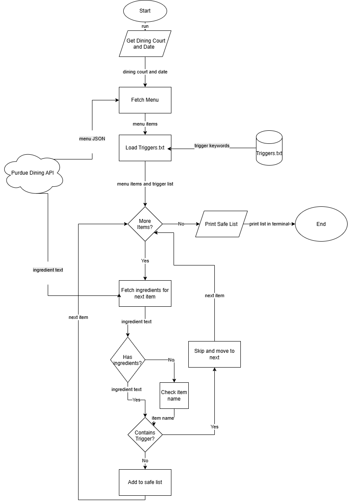

# Low-FODMAP at Purdue

A Java command-line tool that finds low-FODMAP foods at Purdue's dining courts.

## Project Goal

In the Purdue Dining Menu app, there is no filter for high-FODMAP foods. High-FODMAP foods include, but are not limited to, apples, blackberries, broccoli, garlic, onions, wheat, and beans. Currently, I have to go to each item and check the ingredient list, and sometimes the ingredients are vague.

This program takes the dining court and date, pulls the menu from Purdue Dining's API, checks each item's ingredients against a list of high-FODMAP ingredients, and shows which foods are safe.

## MVP Scope

Version 1.0 will:

- Take a dining court and date as input
- Request that day's menu from the Purdue Dining API
- Request the ingredient list for each menu item
- Load a list of high-FODMAP trigger ingredients from `triggers.txt`
- Check each item's ingredients against the trigger list (if an item has no ingredient list, check its name instead)
- Print the menu items that are low-FODMAP

## Future Plans

- Turn it into an Android app
- Suggest a full low-FODMAP meal
- Send a notification for when to eat
- Better handling of vague ingredients (for example, "Natural Flavor" or "Spices")

## Tech Stack

- **Language:** Java
- **Libraries/Tools:** `java.net.http` (HTTP requests), Gson (JSON parsing), `java.time` (dates)
- **Data Storage:** `triggers.txt`, a text file of high-FODMAP ingredient keywords, one per line
- **Data Source:** Purdue Dining API
  - Menu: `https://api.hfs.purdue.edu/menus/v2/locations/{court}/{date}`
  - Ingredients: `https://api.hfs.purdue.edu/menus/v2/items/{itemID}`
  - Requests use the header `Accept: application/json` to get JSON back
- **Trigger list source:** Monash University's high-FODMAP foods list

## System Diagram

The Eisenhower Matrix is in [`docs/eisenhower-matrix.pdf`](docs/eisenhower-matrix.pdf).

## Build Plan

1. Setup: GitHub repository, Java project, Gson
2. Fetch and parse the menu for a hardcoded dining court and date; print every item name and ID
3. Fetch and parse each item's ingredients; print them
4. Create `triggers.txt`, list out high-FODMAP ingredients, and load it into the program
5. Match ingredients against the triggers (including items with no ingredient list); print which items are safe and which are flagged
6. Take the dining court and date as user input
7. Error handling: invalid dining court name, badly formatted date, closed dining court or no menu
8. Clean up the output format and finish the README

## Project Structure

    src/                       Java source code
    docs/diagram.png           System diagram
    docs/diagram.drawio        Diagram source file
    docs/eisenhower-matrix.pdf Eisenhower Matrix
    triggers.txt               High-FODMAP ingredient keywords

## Disclaimer

This is a screening tool, not medical advice. It matches ingredient keywords and does not account for serving sizes, which also affect FODMAP content. Always check with dining court staff if you are unsure about an item.
